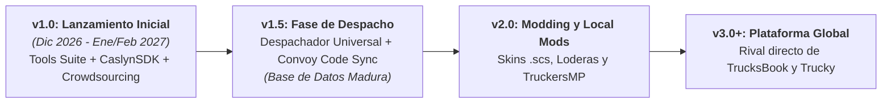

# 🚛 CaslynHub
### La Suite Comunitaria Ultraligera para Euro Truck Simulator 2 & American Truck Simulator
**Un proyecto oficial desarrollado por LT Developer**

  <a href="#-acerca-de-caslynhub">Acerca de</a> •
  <a href="#-comparativa-frente-a-la-competencia">Comparativa</a> •
  <a href="#️-hoja-de-ruta-por-versiones">Hoja de Ruta</a> •
  <a href="#-instalación-y-primeros-pasos">Instalación</a> •
  <a href="#-respaldo-institucional--castores-trucking-vtc">Castores VTC</a> •
  <a href="#-licencia">Licencia</a>

---

> [!IMPORTANT]
> **Estado del Proyecto:** Confirmado oficialmente por **LT Developer** para desarrollo futuro tras la estabilización al 100% de CastoresHub Tracker.  
> 🗓️ **Ventana Estimada de Lanzamiento:** **Diciembre 2026 – Enero / Febrero 2027** (Beta Comunitaria y publicación de la versión 1.0).

---

## 📖 Acerca de CaslynHub

**CaslynHub** es una suite de escritorio de código abierto, gratuita y de alto rendimiento creada por **LT Developer**. Diseñada para sustituir clientes pesados basados en Electron (como Trucky) y herramientas desactualizadas (como Virtual Speditor o ETS666), CaslynHub reúne todo lo que un conductor virtual necesita en un binario nativo que consume **menos de 60 MB de memoria RAM y genera 0% de impacto en los FPS del simulador**.

### 🌟 Pilares Principales:
* 🛠️ **Tools Suite de Partida:** Pit-Stop en 1 clic (reparación/combustible/sueño), Swaps mecánicos con/sin retarder, clonador masivo de rines y save cleaner.
* 📊 **Telemetría Lite:** Bitácora visual local ("Mis Entregas") en SQLite mediante la DLL nativa propietaria `CaslynSDK.dll`.
* 📡 **Crowdsourcing 5-en-1:** Mapeo automático de nuevas ciudades, empresas, cargas, remolques y mapas hacia la API Central.
* 📦 **Despachador Universal (v1.5+):** Generación e inyección libre de cargas con soporte de códigos de convoy (`CASLYN:xxxxxx`).

---

## ⚡ Comparativa frente a la Competencia

| Característica | Trucky App | TrucksBook | PickUP / TruckersHub | CaslynHub (LT Developer) |
| :--- | :---: | :---: | :---: | :---: |
| **Tecnología Base** | Electron / Chromium | Cliente C++ / Web | Web / Cliente VTC | **Tauri + Rust + C++ Nativo** ⚡ |
| **Consumo de Memoria RAM** | 500 MB – 1 GB ❌ | Ligero ⚠️ | Variable ⚠️ | **< 60 MB (Ultra Liviano)** ✅ |
| **Impacto en FPS** | Tirones notables ❌ | Mínimo | Mínimo | **0% de impacto (Nativo)** ✅ |
| **Despachador de Cargas** | ❌ No | ❌ No | ❌ No | **✅ Sí (Universal + Convoy Code)** |
| **Tools de Partida (Pit-Stop/Swaps)** | ❌ No | ❌ No | ❌ No | **✅ Sí (En 1 solo clic)** |
| **Generador de Mods (.scs)** | ❌ No | ❌ No | ❌ No | **✅ Sí (Skins y Loderas)** |
| **Modelo de Acceso** | Con publicidad / Pago | Restrictivo | Solo VTCs socias | **100% Libre y Gratuito** ✅ |

---

## 🗺️ Hoja de Ruta por Versiones

<b>🟢 Versión 1.0 — Lanzamiento Inicial (Objetivo: Diciembre 2026 – Febrero 2027)</b>

 

* 🛠️ **Tools Suite Esencial:** Pit-Stop en 1 clic (reparación 100%, gasolina al máximo y reseteo de fatiga), Swaps mecánicos con selector de transmisiones Allison (con y sin retardador), Clonador de rines por lote, Clonador de `controls.sii`, Save Cleaner y Auditor Anti-Kick para TruckersMP.
* 🔌 **CaslynSDK & Telemetría Lite:** DLL nativa `CaslynSDK.dll` (C++ x64) instalada automáticamente en Steam. Pestaña **"Mis Entregas"** con historial visual local en SQLite (sin inicios de sesión ni burocracia de VTC).
* 📡 **Motor Crowdsourcing 5-en-1:** Detecta silenciosamente ciudades, empresas, cargas, remolques y mapas/DLCs nuevos, enviando reportes automáticos a la API Central para enriquecer la base de datos de todos.
* 🔄 **Actualizador Automático:** Integrado con GitHub Releases y firmas Minisign (cero costos de servidor).

<b>🔵 Versión 1.5 — Despachador Universal & Convoy Code</b>

 

* 📦 **Despachador Universal de Cargas:** Generación libre de cargas inyectadas en `game.sii` con respaldo automático, utilizando el catálogo maduro de empresas y cargas aportadas por la comunidad en la v1.0.
* 🔗 **Sistema "Convoy Code":** Comparte rutas idénticas con amigos al instante usando un código corto (`CASLYN:7x9b1a`).
* 📍 **Teletransportación Táctica:** Posiciona tu camión frente a la bahía de carga de la empresa de origen para arrancar sin demoras.

<b>🟣 Versión 2.0 — Modding Rápido y Local Mods</b>

 

* 🎨 **Generador de Skins `.scs`:** Diseñador rápido de pinturas para camiones y remolques listo para `/mod/`.
* 🛡️ **Creador de Loderas / Mudflaps:** Personalización de faldillas con logos y textos.
* 🚚 **Local Mods para TruckersMP:** Interiores y accesorios cosméticos locales visibles en primera persona en multijugador.

<b>🔴 Versión 3.0+ — Plataforma Comunitaria Global</b>

 

* 🏆 Tablas de clasificación y ránkings de kilometraje comunitarios en la nube (*opt-in* voluntario).
* 📡 API Pública REST y WebSocket local para overlays de OBS Studio y plugins de Elgato Stream Deck.

---

## 🚀 Instalación y Primeros Pasos

1. Dirígete a la sección de **[Releases](https://github.com/LT-Developer/caslynhub/releases)**.
2. Descarga el instalador oficial más reciente (`CaslynHub-Setup-x64.msi`).
3. Ejecuta el instalador. CaslynHub detectará automáticamente tus instalaciones de Steam de ETS2 y ATS.
4. ¡Listo! `CaslynSDK.dll` se configurará sola y podrás disfrutar de todas las herramientas de inmediato.

---

## 🛠️ Requisitos del Sistema

* **Sistema Operativo:** Windows 10 / Windows 11 (64 bits).
* **Juegos Compatibles:** Euro Truck Simulator 2 y/o American Truck Simulator (versiones oficiales de Steam).
* **Espacio en Disco:** < 40 MB.
* **Memoria RAM:** < 60 MB en ejecución (100 MB recomendados).

---

## 🦫 Respaldo Institucional & Castores Trucking VTC

CaslynHub es un proyecto impulsado por **LT Developer** que cuenta con el respaldo tecnológico y la infraestructura de servidores de **Castores Trucking VTC**.

> ### 🚛 ¿Buscas una Empresa Virtual Organizada para Rodar en Convoy?
> Si juegas Euro Truck Simulator 2 o American Truck Simulator y buscas una comunidad apasionada, organizada y con convoyes semanales en TruckersMP y modo Convoy de SCS:
> 
> 👉 **[¡Conoce a Castores Trucking y Únete a su Discord Oficial!](https://discord.gg/castorestrucking)**

---

## 🤝 Créditos y Enlaces Oficiales

* **Desarrollo de Software:** [LT Developer](https://github.com/LT-Developer)
* **Infraestructura de Datos:** [API Central de Castores Trucking](https://api.castorestrucking.mx)
* **Comunidad y Soporte:** [Discord de Castores Trucking](https://discord.gg/castorestrucking)

---

## 📄 Licencia

Este proyecto está bajo la Licencia [MIT](LICENSE) — libre para la comunidad global de simulación.
